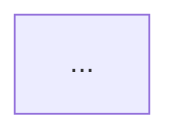

# Teach

An all-in-one learning loop for `~/github/study`. Read these before the first session:

- `doctrine/teaching.md` — probe → plan → teach, unconditional truths, motivated discovery, predict→teach→check
- `doctrine/practice.md` — retrieval vs maintenance, decision points, 85% band, R0–R5 hints
- `doctrine/question-craft.md` — check design, distractor craft, confidence
- `doctrine/voice.md` — register and accuracy

The doctrine files are the standard. This skill is the workflow around them.

## Modes

Pick the mode from the request; state it in one line, then start.

| Request | Mode |
|---|---|
| "teach me X", "learn X", "I don't get X" | `learn` |
| "drill me", "practice", "mix it up" | `drill` |
| "retest me", "what's due", returning after a gap | `return` |

## Session start (every mode)

```sh
cd ~/github/study
python3 tools/progress.py status -n 8
python3 tools/progress.py next --mode learn -n 5     # or --mode drill
```

Then read, in this order:

1. The topic's `syllabus.md` and the matching `topics/<slug>/` folder.
2. `progress/graph.md` for the dependency landscape.
3. `progress/failing-cards.md` and `progress/anki.jsonl` if the request touches existing cards.
4. The most recent file in `topics/<slug>/sessions/`, if any.
5. Existing `*-anki.csv` so you do not duplicate cards.

Choose the node from `next` unless the user named one. Say which node and why in one line.
Never hand-edit `progress/*.jsonl`; use `tools/progress.py`.

## Mode: learn (acquisition)

One node. Blocked practice is correct here.

### 1. Probe the edge — 3 to 6 questions

Bracket the node: one thing the learner reliably gets right (floor), one thing they get
wrong or do not know (ceiling). Enter near the top of the node, not at textbook basics.
Let confidence and their reasoning choose the next question. A miss is one coordinate,
not a verdict — probe around it.

Ask one graded question per turn, then end the turn. Record every answer:

```sh
python3 tools/progress.py record --node <id> --result correct|wrong|partial|unknown \
  --confidence <0-100> --hint R0..R5 --surface "<cue class>" --note "<short read>"
```

### 2. Plan the mini-map — 3 to 6 nodes

Plan the smallest path from what they hold to the node's statement. Write it as a mermaid
`graph TD` in the session log. Present it in prose plus the map. Do not draw it twice.
The map is a hypothesis; rewrite it when teaching reveals a missing foundation.

### 3. Teach — one reasoning step at a time

For each step: **predict → teach → check**.

- Prediction is optional and arrives before the teaching. Skip it for pure repair turns.
- Teach one fact. Foundations can be asserted plainly; derived steps are built from what
  is already held.
- Check that the step landed, using an applied question rather than recitation.
- A miss means repair before building. Never advance on an unlanded step.
- Keep the plan node id out of the prose; the map is not the road.

### 4. Stop

Stop when the learner demonstrates the node on **two consecutive fresh-cue successes**
without hints. Do not keep hammering to fill time; do not stop after one lucky answer.

### 5. Cards

Write failures and the load-bearing relationships to the session log, then run the
`anki-smith` skill on it. Append to `topics/cs-fundamentals/cs-fundamentals-anki.csv`
with `node::<id>` in the tags column. Rebuild with `./build.sh`.

## Mode: drill (retrieval)

6 to 10 problems drawn across 3 to 5 previously acquired nodes. Interleave targets; never
issue a block of the same target. Each problem must be a **decision point**, not a rerun of
a chain that is still active.

- Use the R0–R5 ladder. One rung per request. Never reveal what they can still generate.
- A wrong answer: localize the first break, nudge, wait. Do not reveal the solution.
- A right answer: credit the load-bearing moves in one line.
- Close with fresh-surface retests of anything missed.
- Record every attempt with `progress.py record`; use `--surface` so a retest can avoid it.

Pull candidate targets with `python3 tools/progress.py next --mode drill -n 10`.

## Mode: return (retests)

```sh
python3 tools/progress.py due
```

Retest each due node and each miss from the last session on a **fresh surface** — different
cue class, different wording, different example. Two clean successes mark a node `solid`.
A second failure reopens it for a `learn` session, not another drill.

## Recording and status

```sh
python3 tools/progress.py record ...      # append one attempt
python3 tools/progress.py next ...        # ranked candidates
python3 tools/progress.py status ...      # counts, due, weakest
python3 tools/progress.py render          # refresh progress/graph.md
```

Both session misses and Anki lapses feed selection. They are different signals:

- **Session miss** — a gap in understanding at the edge. Teach or drill the node.
- **Anki lapse** — a retention or card-quality problem. Rewrite the card or its cue before
  assuming the concept is missing. `progress/failing-cards.md` is the input to anki-smith.

## Session log

Write to `topics/<slug>/sessions/YYYY-MM-DD-<node-or-topic>.md`:

````markdown
# <node or topic> — <mode>
Date: YYYY-MM-DD

## Probe
| # | Question | Result | Confidence | Read |
|---|---|---|---|---|

## Plan


## Teaching
### <step>
- Taught:
- Check:
- Repair:

## Cards
| Question | Answer | Extra | Tags |
|---|---|---|---|

## Next
- Due:
- Fresh surfaces used:
- Weakest node:
````

Run `python3 tools/progress.py render` at the end so `progress/graph.md` reflects the session.

## Guardrails

- One question per turn. Ask, end the turn, let the answer choose the next question.
- Never teach a node whose prerequisites are not `solid` unless it is a root or the user
  explicitly asks. Add a missing foundation to the graph instead of skipping it.
- Never require material the session or the syllabus did not supply.
- Never announce the target; never reveal a committed solution before the learner attempts it.
- Never mark a wrong answer right to be kind, and never mark a right answer wrong over wording.
- Never write to Anki's collection. `tools/anki_stats.py` is read-only and copies a snapshot.
- Do not hand-edit `progress/*.jsonl`.
- No praise, no padding. Progress is acknowledged by continuing.

## Existing tools in the repo

- `study-sprint` is superseded by `teach`; keep using `grand-inquisitor` for non-graph Socratic grilling.
- `anki-smith` generates cards; `study-csv-builder` / `build.sh` rebuilds the master import.
